### Hi, I'm Vyacheslav 👋

I build web products and business automations end to end, from spec to production, with AI agents doing most of the typing and me owning the design, the decisions and the quality bar.

My workflow is spec-driven: **spec → plan → tasks → implementation → verification**. I run Claude Code as an orchestrator. Parallel agents work in isolated git worktrees, and every change passes typecheck, tests and an independent review before it ships. The result is code that keeps working when a client comes back with new requirements.

> Product and client code lives in private repositories. I'm happy to do a live walkthrough or share code for review on request.

**Contents:** [DearTeacher](#-dearteacher-an-online-classroom-for-english-tutors) · [LifeOS](#-lifeos-a-personal-operating-system-for-everyday-life) · [YouTube Digest Bot](#-youtube-digest-bot-video-summaries-in-telegram) · [Business automations](#%EF%B8%8F-business-automations) · [Stack](#-what-i-work-with)

---

## 🎓 DearTeacher: an online classroom for English tutors

**Live in production:** [dearteacher.ru](https://dearteacher.ru)

A platform for private English teachers who teach online. The teacher builds lessons from interactive exercises, runs them live with students on a shared screen, sets homework and reviews it with real feedback. Students get a cabinet that rewards progress. I built it from scratch to replace a slow, crash-prone incumbent the teachers were using: every page has a load budget written down as a number, and no student answer may ever be lost.

<p align="center">
  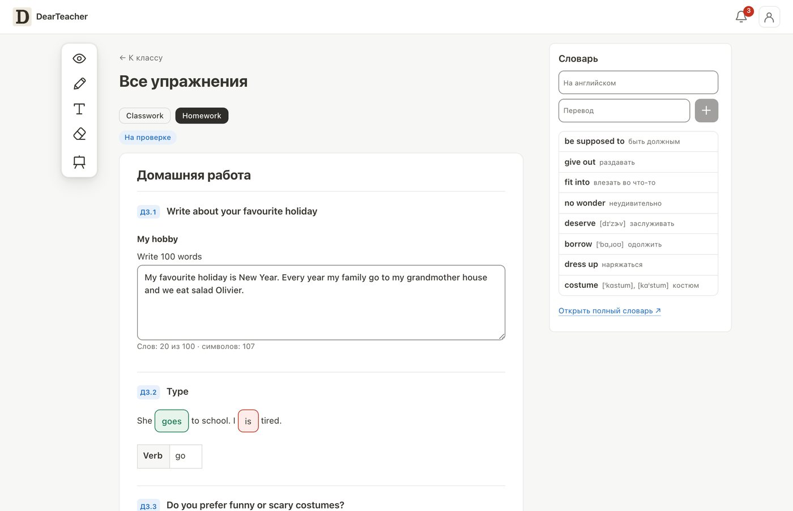
</p>

**For the teacher**
- **Lesson builder** with 32 exercise types: gap fills, drag and drop, matching, ordering, image choice, essays, voice answers and more. One zod schema per block drives the renderer, the editor and the AI tool inputs, so they never drift apart.
- **Live lesson** on a shared screen: the teacher points at an exercise, draws on top of it with a pen, highlighter, arrows and text, locks or hides parts of the lesson, and sees every student answer the moment it is typed. Real-time sync runs over Centrifugo, with collaborative editing on Yjs and Hocuspocus.
- **Classes and schedule:** individual students and groups, a weekly calendar with Google Calendar sync, and class notes.
- **Homework review** with inline comments, rework requests and student photo uploads, instead of a bare "accept / reject".
- **Vocabulary** per class, per course and per student, with transcription, translation and import.
- **Next up, an MCP connector:** a teacher drafts a lesson in Claude or ChatGPT and publishes it straight to the platform. It already works in the prototype that preceded DearTeacher.

**For the student**
- Lessons and homework in one place, with instant checking and a personal dictionary.
- **A picture made of words:** every word a student masters becomes a stroke in an artwork drawn by code (a wave, a warm pie). The first fifty words complete the first picture, and each finished picture joins the collection.
- **A bookshelf:** each course section turns into a book after its first passed lesson and grows thicker with every lesson after that.

<table>
  <tr>
    <td width="50%">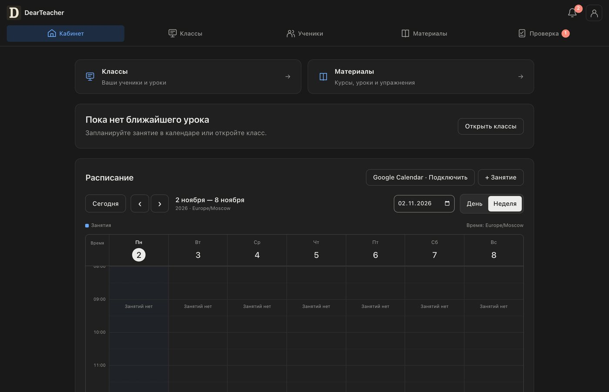</td>
    <td width="50%">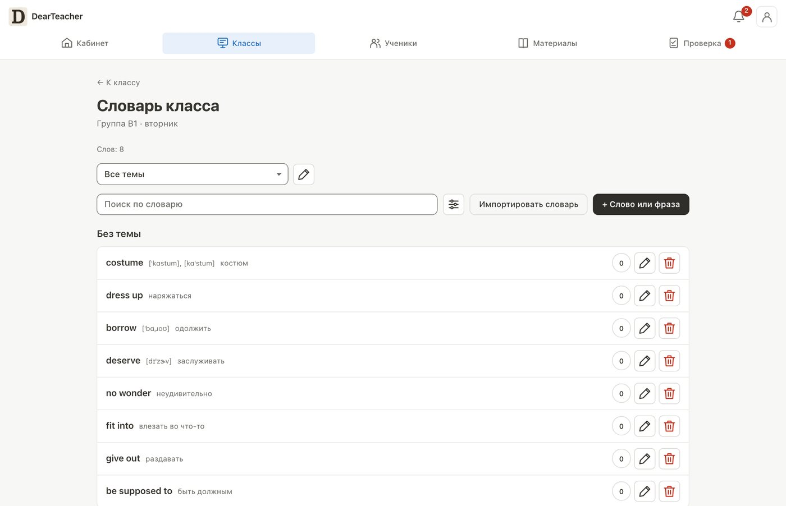</td>
  </tr>
  <tr>
    <td width="50%">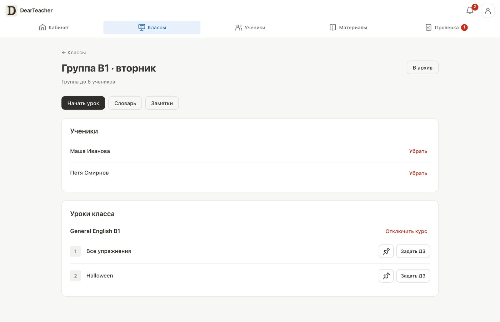</td>
    <td width="50%">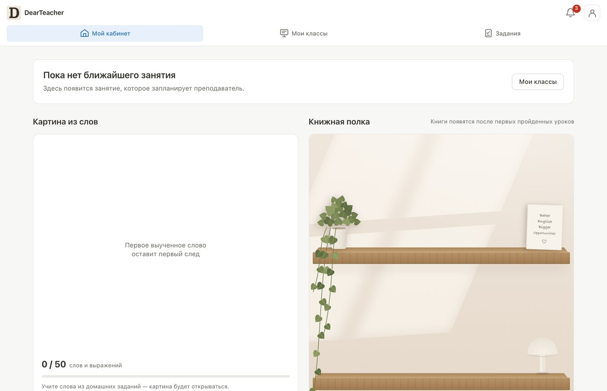</td>
  </tr>
</table>

<p align="center">
  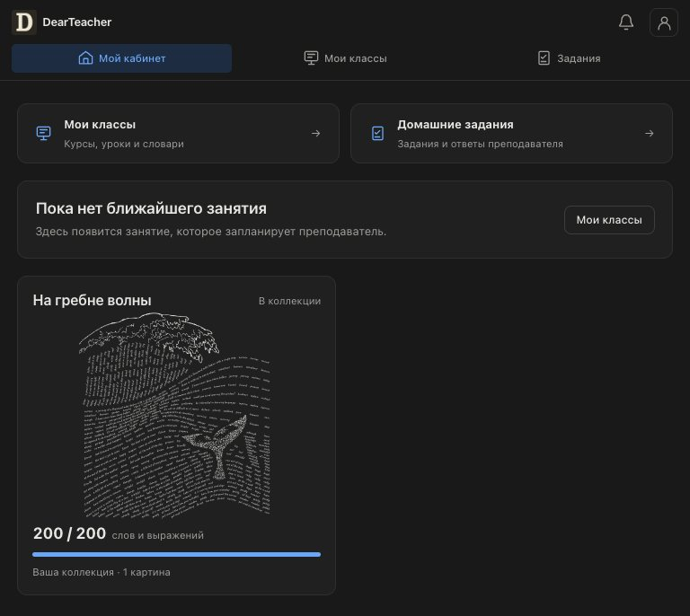
  <br><sub>A finished picture: 200 learned words and phrases form the wave</sub>
</p>

**Engineering**
- Hosted in Russia on its own VPS to comply with the local data law (152-FZ), with Yandex ID and VK ID sign-in and transactional email.
- Release discipline: every deploy is recorded with its image hash, verified as live before the switch, and gated by about 900 tests. Playwright e2e runs across Chromium, Firefox and WebKit in light and dark themes, plus load tests against the production VPS.
- Architecture decisions as ADRs, product requirements as a PRD with numeric targets, infrastructure in Terraform.

`Next.js` `TypeScript` `PostgreSQL` `Drizzle` `Better Auth` `Yjs` `Hocuspocus` `Tiptap` `Excalidraw` `Centrifugo` `S3` `Docker` `Terraform` `Playwright`

---

## 🧭 LifeOS: a personal operating system for everyday life

One app instead of five: goals, habits, food, money, media and travel, built around a single daily ring called **"Today"**. Tick off the day's actions, log meals and spending, and the day closes and the streak grows. It started as a habit tracker for myself and grew into a native iOS app with a home-screen widget, now being polished for the App Store.

<table>
  <tr>
    <td width="33%">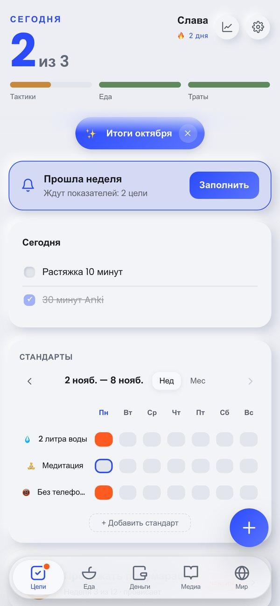</td>
    <td width="33%">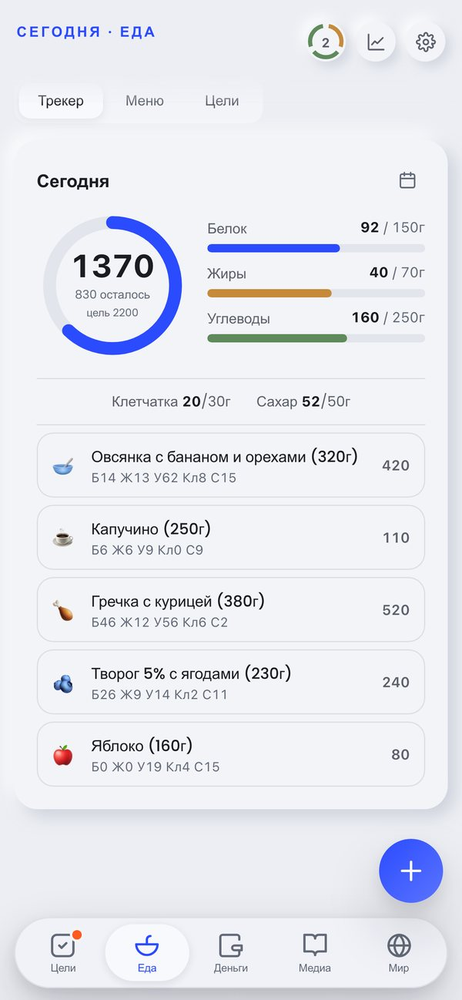</td>
    <td width="33%">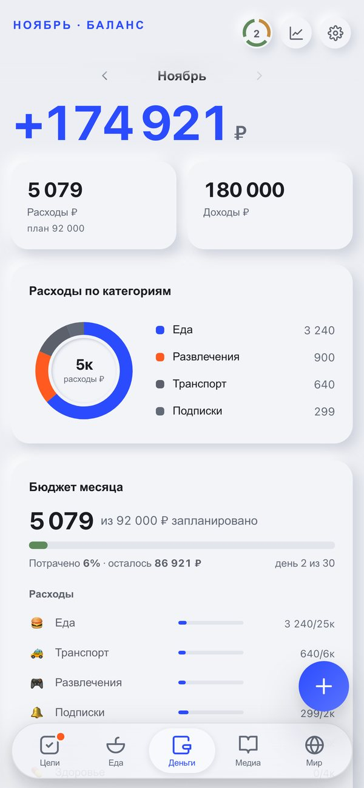</td>
  </tr>
  <tr>
    <td width="33%">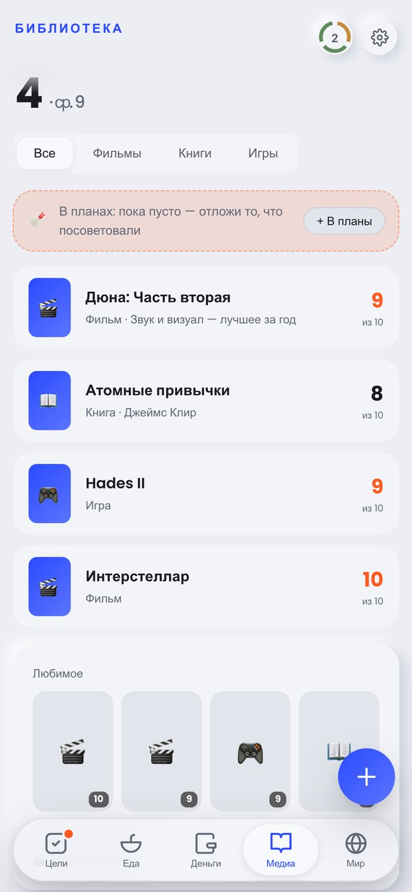</td>
    <td width="33%">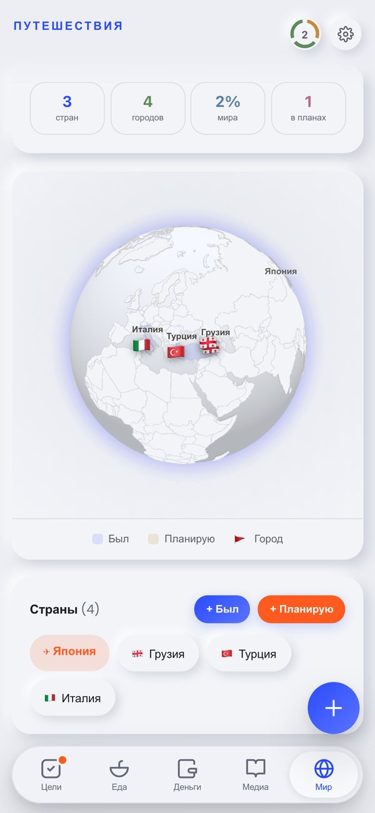</td>
    <td width="33%">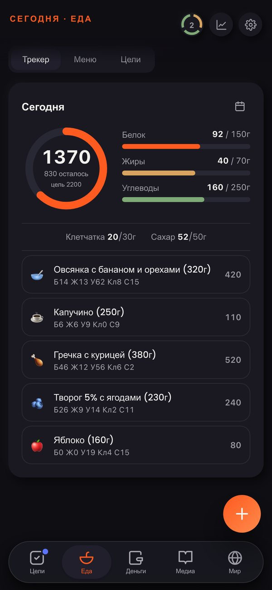</td>
  </tr>
</table>

- **Goals on a 12-week cycle:** a big goal breaks down into simple daily tactics, with weekly check-ins on the numbers that matter. Habits sit alongside as weekly "standards".
- **Food without friction:** type "buckwheat with chicken 300g", say it out loud, or snap a photo. A local database of common foods handles composite dishes, portions and dry versus cooked weight with no network call, and an AI model covers the rest. The ring shows calories, protein, fat, carbs, fibre and sugar against your targets.
- **Money:** a monthly budget by category, a daily safe-to-spend figure, savings goals and debt payoff. A family budget syncs between partners in real time.
- **Media and travel:** a library of films, books and games with ratings, and an interactive globe of visited and planned countries.
- **Monthly wrap-ups** generated by AI, and an onboarding flow that hides the sections you don't need.

**Engineering**
- A framework-free single-page app in vanilla JS, offline-first behind a service worker. Data lives on the device, and no account is required.
- Native iOS shell on Capacitor, with a WidgetKit home-screen widget that talks to the web layer through a native bridge.
- AI calls go through a Supabase Edge Function with a per-user and global monthly quota, so API keys never reach the client.
- A pre-release security audit, about 240 automated tests, and UX tested with simulated user personas before real users.

`JavaScript` `PWA` `Service Worker` `Supabase` `Edge Functions` `Gemini` `Capacitor` `Swift / WidgetKit`

---

## 📺 YouTube Digest Bot: video summaries in Telegram

A Telegram bot that turns YouTube videos into readable summaries with timecodes. Send a link or subscribe to channels, and new videos arrive already summarized. Long summaries are published as Telegraph pages, and you can **ask questions about a video** and get answers grounded in its transcript.

- Summary depth adapts to video length, with a completeness check and a retry with fallback when the model under-delivers
- Q&A over transcripts through chunking and embeddings
- A channel poller that catches new uploads and works around the EU consent wall
- Credit-based monetization with card payments via YooKassa, plus an admin funnel with conversion stats
- Async Python: aiogram 3, SQLAlchemy and asyncpg, Alembic migrations, network retries; deployed on Google Cloud Run

`Python` `aiogram` `PostgreSQL` `SQLAlchemy` `Gemini` `Embeddings` `YooKassa` `Cloud Run`

---

## ⚙️ Business automations

Production workflows I've built for real businesses. Each one replaced a manual routine that someone used to do by hand every day.

### 🧾 Invoice collection from a Telegram chat
**2 minutes per invoice → 2 seconds.** Every department dropped invoices into one shared Telegram chat, mixed in with everything else. Now a bot notices every invoice (PDF or a blurry phone photo), reads it with Gemini Flash, matches the supplier against the company directory with GPT-4o to pick the department and expense category, and writes it to a shared spreadsheet with the file attached. At the end of the day the accountant opens one table with every invoice ready to pay, with nothing lost or duplicated.

```
✅ Invoice processed
Supplier: Example LLC · Amount: 15,985 ₽
Department: Marketing · Owner: Alina
📎 File saved, linked in the shared sheet
```
`Telegram Bot API` `Gemini Flash` `GPT-4o` `Google Sheets / Drive` `n8n` · recognises 25 expense categories on its own

### 🤖 24/7 AI support for employees (RAG)
New employees ask a Telegram bot instead of interrupting a senior colleague. The bot loads 15+ internal documents (instructions, checklists, equipment manuals) from Google Drive, splits them into chunks, stores embeddings in Supabase pgvector and answers **only from the retrieved passages**, with memory of the last few messages. When asked to calculate a 6×4 m LED screen's resolution at a 1.5 mm pixel pitch, it applies the formula from the manual and answers *4000 × 2667 px*.

`Telegram Bot API` `GPT-4o` `Embeddings` `Supabase pgvector` `n8n AI nodes`

### 🧮 Automatic fiscal receipts (ATOL Online)
**1,000+ receipts a month with no manual work, where it used to take about 20 hours.** Every online order, including refunds, now becomes a legally valid cash receipt for one of two sole proprietors on different tax regimes. The workflow picks the regime from the VAT type, normalises phone numbers so the register doesn't reject them, gets an ATOL token, fiscalises the receipt and writes the receipt number or the error back to the order. It covers 4 scenarios (sale or refund on either tax regime). It is deliberately deterministic, with no AI involved, because a wrong legal entity costs real fines.

`ATOL Online API` `Google Sheets API` `n8n`

### 📊 Budget control for expense requests
Expense requests in Jira now link themselves to the right budget ticket, recalculate the remaining budget when a request is created, changed or cancelled, and warn the owner before a limit is exceeded. Requests are routed by type (travel, non-reimbursable expenses, workplace). Plan and actuals are pulled from the data warehouse once a week, so 100% of requests land on a budget with nobody linking them by hand.

`Jira REST API` `Webhooks` `Google Sheets` `n8n`

---

## 🛠 What I work with

**Product:** Next.js · TypeScript · React · Node.js · Python · PostgreSQL · Supabase · Drizzle
**AI:** Claude · GPT · Gemini · MCP servers and connectors · RAG and embeddings · LLM pipelines
**Automation:** n8n · Telegram bots · webhooks · Jira, Google Workspace and payment APIs
**Quality:** Vitest · Playwright · pytest · CI gates · code review by independent agents
**Infra:** Vercel · Google Cloud Run · VPS · Docker · Terraform · GitHub Actions
