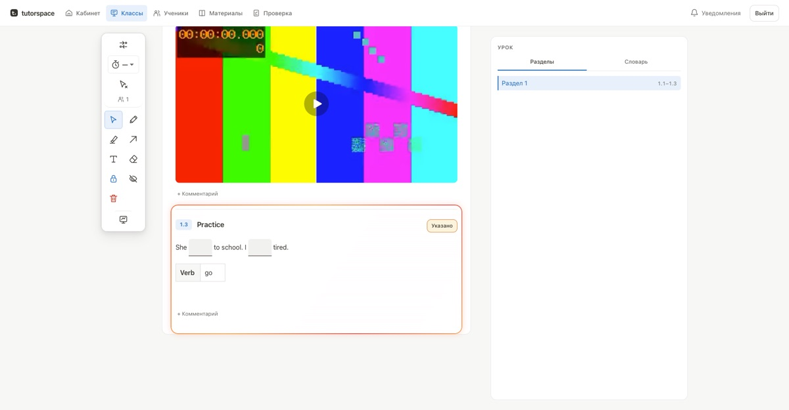
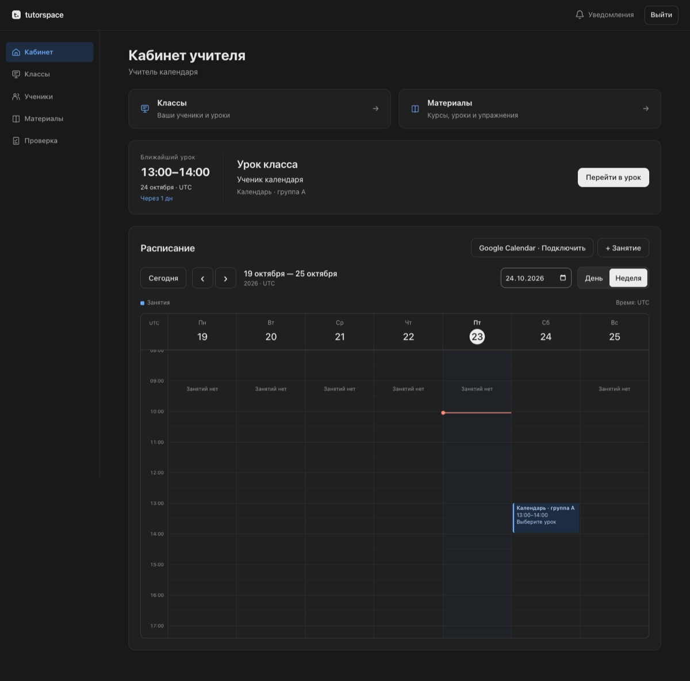

### Hi, I'm Vyacheslav 👋

I build web products end to end, from spec to production, with AI agents doing most of the typing and me owning the design, the decisions and the quality bar.

My workflow is spec-driven: **spec → plan → tasks → implementation → verification**. I run Claude Code as an orchestrator. Parallel agents work in isolated git worktrees, and every change passes typecheck, tests and an independent review before it ships. The result is code that keeps working when a client comes back with new requirements.

🌐 Portfolio and case studies: **[ai-cases-tau.vercel.app](https://ai-cases-tau.vercel.app)**

---

## Featured projects

> Client and product code lives in private repositories. I'm happy to do a live walkthrough or share code for review on request.

### 🎓 tutorspace: a platform for English tutors

An online classroom for private English teachers. Lessons are assembled from interactive exercises, assigned to students and run live on a shared screen. The teacher sees every answer in real time. A built-in **MCP connector** lets a teacher draft a lesson in Claude or ChatGPT and publish it to the platform in one step.

  
  

- **Live lessons:** shared screen with drawing tools, real-time sync via Centrifugo, and collaborative editing via Yjs and Hocuspocus
- **Exercise builder:** one zod schema for every block type drives the renderer, the editor and the MCP tool inputs
- **Classes and homework:** students, groups, a schedule with Google Calendar sync, vocabulary lists and homework review with feedback
- **Engineering:** performance budgets written down as numbers in the PRD, ADRs for every major decision, Playwright e2e across Chromium, Firefox and WebKit in light and dark themes, infrastructure in Terraform

`Next.js` `TypeScript` `PostgreSQL` `Drizzle` `Better Auth` `Yjs` `Tiptap` `Excalidraw` `Centrifugo` `S3` `Terraform` `Playwright` `MCP`

### 🧭 LifeOS: a gamified personal operating system

A personal tracker that turns daily life into an RPG, with XP, levels, quests and achievements. It covers tasks and habits, food with macros, money and reports. Food can be logged by text or by **photo**, and an AI model works out the calories and macros. It runs as an installable PWA and ships as an **iOS app with a home-screen widget**.

  
  &nbsp;&nbsp;
  

- Framework-free single-page app: vanilla JS, offline-first service worker
- AI features go through a Supabase Edge Function that proxies Gemini, so API keys never reach the browser
- Native iOS shell on Capacitor with a WidgetKit widget

`JavaScript` `PWA` `Supabase` `Edge Functions` `Gemini` `Capacitor` `iOS / WidgetKit`

▶️ **Live:** [vfilatov7.github.io/LifeOS](https://vfilatov7.github.io/LifeOS/)

### 📺 YouTube Digest Bot: video summaries in Telegram

A Telegram bot that turns YouTube videos into readable summaries with timecodes. Subscribe to channels and new videos arrive already summarized. Long summaries are published as Telegraph pages, and you can **ask questions about a video** and get answers grounded in its transcript.

- Summary depth adapts to video length, with completeness checks and a retry with fallback when the model under-delivers
- Q&A over transcripts through chunking and embeddings
- Credit-based monetization with card payments via YooKassa, plus an admin funnel with stats
- Async Python: aiogram 3, SQLAlchemy and asyncpg, Alembic migrations; deployed on Google Cloud Run

`Python` `aiogram` `PostgreSQL` `SQLAlchemy` `Gemini` `Embeddings` `YooKassa` `Cloud Run`

---

## What I work with

**Product:** Next.js · TypeScript · React · Node.js · Python · PostgreSQL · Supabase · Drizzle
**AI:** Claude · Gemini · MCP servers and connectors · RAG and embeddings · LLM pipelines
**Automation:** n8n · Telegram bots · webhooks · third-party API integrations
**Quality:** Vitest · Playwright · pytest · CI gates · code review by independent agents
**Infra:** Vercel · Google Cloud Run · Docker · Terraform · GitHub Actions
